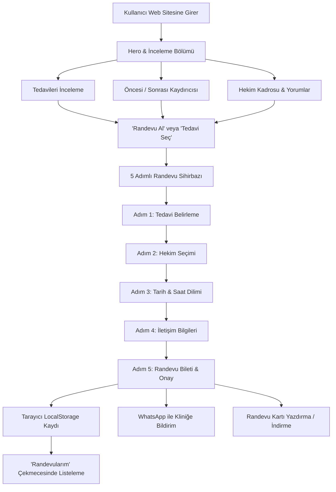

# 🦷 Comodo Dental Centre - Profesyonel Diş Kliniği Web Projesi

Bu proje, Antalya Konyaaltı'nda hizmet veren modern diş kliniği [Comodo Dental Centre](https://asimdentalcentre.com/ referansı ile) için; modern estetik anlayışı, yüksek performanslı **TypeScript + React** mimarisi ve interaktif **Online Randevu Sistemi** ile geliştirilmiş kapsamlı bir kurumsal diş hekimliği web uygulamasıdır.

Proje, **GitHub Pages** üzerinde doğrudan yayına alınabilecek şekilde (bağıl asset yolları ve otomatik GitHub Actions CI/CD akışı ile) optimize edilmiştir.

---

## 🌟 Öne Çıkan Özellikler

1. **İnteraktif 5 Adımlı Randevu Sihirbazı (Online Booking Engine)**:
   - **Tedavi Seçimi**: Yaprak Lamine, Gülüş Tasarımı, Zirkonyum Kaplama, Dental İmplant, Kanal Tedavisi, Lazer Beyazlatma, Şeffaf Plak, Nöbetçi Diş.
   - **Hekim Tercihi**: Kurucu Uzm. Dt. Asım Özün (Diş Protez Uzmanı), Uzm. Dt. Selin Demir (Çene Cerrahisi) ve Dt. Kerem Yıldız.
   - **Tarih & Saat Dilimi Seçimi**: İnteraktif takvim ve sabah/öğleden sonra seans kutucukları.
   - **Hasta Bilgileri**: Ad Soyad, Telefon, E-posta, Şikayet Notu ve 4 Dilde İletişim Tercihi (TR, EN, DE, RU).
   - **Bilet & Onay Kartı**: Benzersiz randevu referans kodu (`ADC-XXXX`), doğrudan WhatsApp onay mesajı oluşturma, Google Takvime ekleme ve yazdırma olanağı.
   - **Kalıcı Randevu Yönetimi (`localStorage`)**: Hastalar oluşturdukları randevuları "Randevularım" panelinden görüntüleyebilir veya dilediklerinde iptal edebilir.

2. **Canlı Öncesi ve Sonrası (Before / After) Gülüş Kaydırıcısı**:
   - Ziyaretçilerin fareyle veya parmakla sağa-sola sürükleyerek porselen lamine ve gülüş tasarımı sonuçlarını gerçek zamanlı inceleyebildiği interaktif görsel bileşen.

3. **Zengin Tedavi Kataloğu ve Detay Modalları**:
   - Her tedavinin klinik aşamalarını, sürelerini ve avantajlarını açıklayan pop-up pencereler ve doğrudan o tedaviye randevu oluşturma entegrasyonu.

4. **Gerçek Hasta Yorumları ve Güven Rozetleri**:
   - Google Reviews (4.7★) ve Trustpilot (4.8★) onaylı hasta değerlendirmeleri, karusel geçişi ve ziyaretçilerin kendi yorumlarını bırakabileceği dinamik form.

5. **Comodo Dental Centre Kurumsal Tasarımı**:
   - Gece mavisi (`#191E26`), ışıltılı yıldız sarısı (`#F6B400`) ve medikal indigo (`#5D5FEF`) tonlarında lüks renk ahengi.
   - Mobilde Comodo Dental Centre yapısına sadık kalınarak tasarlanan sabit alt eylem çubuğu (`Hemen Ara`, `Randevu Al`, `WhatsApp`).

---

## 🏗️ Projenin Akışı ve Mimarisi



---

## 📁 Proje Dizin Yapısı

```
dental/
├── .github/
│   └── workflows/
│       └── deploy.yml            # Otomatik GitHub Pages derleme ve dağıtım iş akışı
├── frontend/
│   ├── public/
│   │   ├── favicon.svg           # Kliniğe özel diş ve yıldız faviconu
│   │   └── images/               # Yüksek çözünürlüklü klinik, hekim ve gülüş fotoğrafları
│   │       ├── clinic_hero.jpg
│   │       ├── doctor_asim.jpg
│   │       ├── doctor_selin.jpg
│   │       ├── smile_before.jpg
│   │       └── smile_after.jpg
│   ├── src/
│   │   ├── components/           # Modüler React bileşenleri
│   │   │   ├── TopBar.tsx
│   │   │   ├── Navbar.tsx
│   │   │   ├── Hero.tsx
│   │   │   ├── QuickFeatures.tsx
│   │   │   ├── TreatmentsSection.tsx
│   │   │   ├── TreatmentDetailModal.tsx
│   │   │   ├── BeforeAfterSlider.tsx
│   │   │   ├── AboutSection.tsx
│   │   │   ├── DoctorsSection.tsx
│   │   │   ├── ReviewsSection.tsx
│   │   │   ├── FaqSection.tsx
│   │   │   ├── ContactSection.tsx
│   │   │   ├── Footer.tsx
│   │   │   ├── FloatingActions.tsx
│   │   │   ├── AppointmentModal.tsx
│   │   │   └── MyAppointmentsModal.tsx
│   │   ├── data/                 # Tedavi, hekim, yorum ve SSS veri setleri
│   │   ├── types/                # TypeScript tip ve arayüz tanımları (types/index.ts)
│   │   ├── App.tsx               # Ana uygulama ve durum yönetimi
│   │   ├── index.css             # Vanilla CSS tasarım sistemi (Tokens, Variables)
│   │   └── main.tsx
│   ├── vite.config.ts            # base: './' ile GitHub Pages alt yol uyumluluğu
│   ├── package.json              # Bağımlılıklar, build & gh-pages betikleri
│   └── README.md                 # Frontend'e özel detaylı işlem notları
├── backend/                      # Gelecekteki API / Veritabanı genişlemeleri için hazır dizin
└── README.md                     # Genel proje akışı ve kullanım kılavuzu
```

---

## 🛠️ Teknoloji Yığını

- **Dil**: TypeScript (~5.7+ / ES2023)
- **Kütüphane**: React 19 + React DOM
- **Derleyici & Sunucu**: Vite 8.3
- **Stil & Tasarım**: Vanilla CSS (CSS Variables, Grid, Flexbox, Glassmorphism)
- **İkonlar**: Lucide React
- **Veri Saklama**: HTML5 LocalStorage (Kullanıcı randevularını cihazda hatırlar)
- **Dağıtım**: GitHub Pages & GitHub Actions CI/CD

---

## 💻 Yerel Olarak Çalıştırma

Projeyi bilgisayarınızda yerel ortamda çalıştırmak için:

```bash
# 1. Frontend dizinine geçin
cd frontend

# 2. Bağımlılıkları kurun
npm install

# 3. Geliştirme sunucusunu başlatın
npm run dev
```

Sunucu başladığında tarayıcınızda `http://localhost:5173/` adresine giderek siteyi anında görüntüleyebilirsiniz.

---

## 🚀 GitHub Pages Üzerinden Yayına Alma

Bu proje GitHub Pages üzerinde çalışacak biçimde iki farklı yöntemle yapılandırılmıştır:

### Yöntem 1: Otomatik Dağıtım (GitHub Actions - Tavsiye Edilen)
Depoda bulunan [`.github/workflows/deploy.yml`](.github/workflows/deploy.yml) dosyası sayesinde:
1. GitHub reponuzda **Settings (Ayarlar) > Pages** sekmesine gidin.
2. **Build and deployment > Source** seçeneğini **GitHub Actions** olarak ayarlayın.
3. Projeyi `main` branch'ine push ettiğinizde, GitHub Actions otomatik olarak `frontend` projesini derleyip `https://<kullanici-adi>.github.io/<repo-adi>/` adresinde yayına alacaktır.

### Yöntem 2: `gh-pages` ile Manuel Dağıtım
Dilerseniz tek bir komutla derleme ve yayınlama yapabilirsiniz:
```bash
cd frontend
npm run deploy
```
Bu komut önce projeyi derler (`npm run build`), ardından oluşan `dist` klasörünü otomatik olarak `gh-pages` branch'ine yükler.

---

## 📞 Klinik İletişim Bilgileri (Demo Bilgileri)

- **Klinik Adı**: Comodo Dental Centre
- **Kurucu**: Uzm. Dt. Asım Özün (Diş Protez Uzmanı)
- **Telefon**: 0507 8505 287
- **E-posta**: iletisim@comododental.com
- **Adres**: Gürsu Mah. Gazi Mustafa Kemal Blv. No:57/2, 07070 Konyaaltı / Antalya
- **Çalışma Saatleri**: Pazartesi - Cumartesi: 10:00 - 19:00 (Pazar: Nöbetçi Acil Servis)
